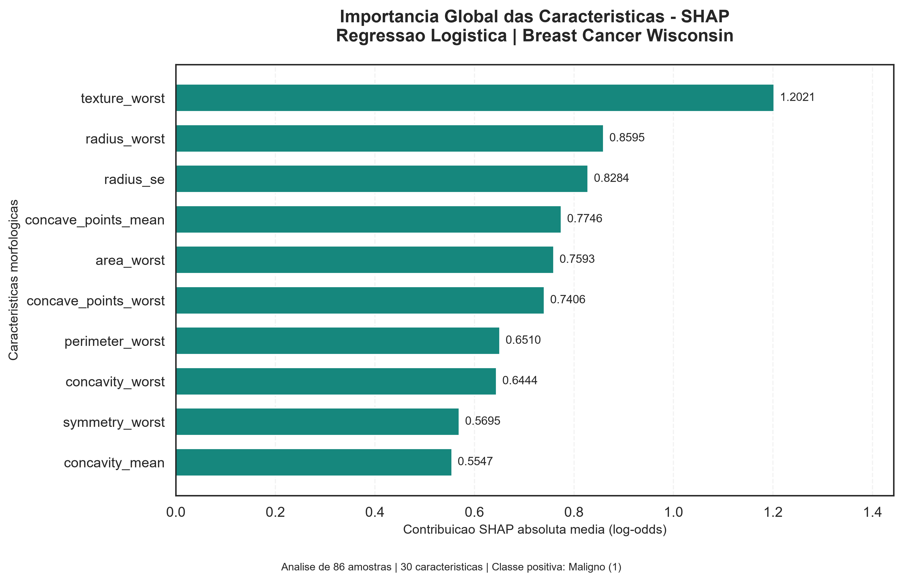
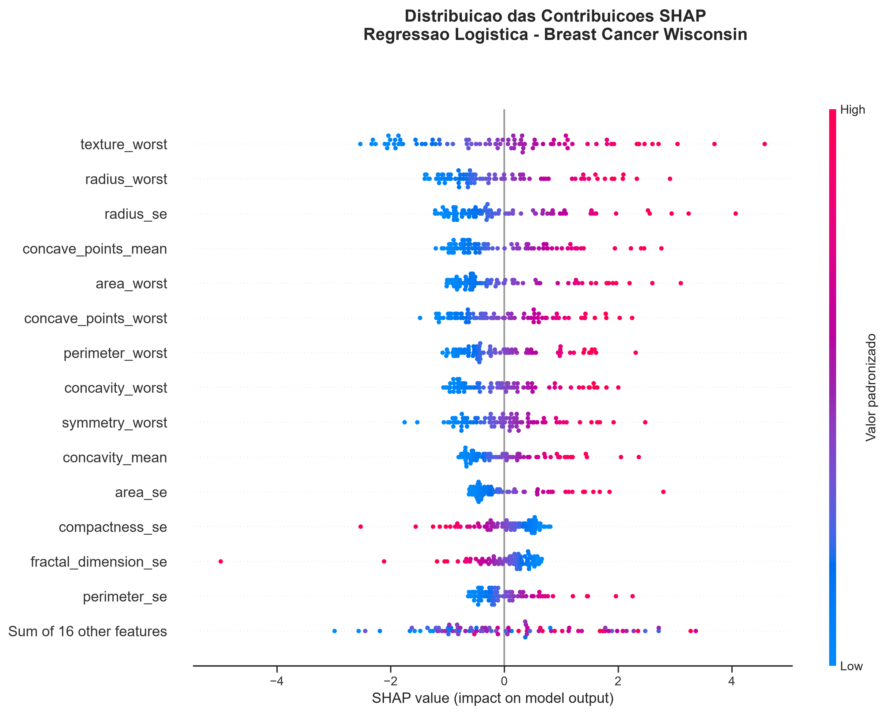

# Tech Challenge FIAP — Fase 1
## Classificação de amostras do Breast Cancer Wisconsin com Inteligência Artificial Explicável

> **Projeto acadêmico e experimental.** Esta aplicação não é um dispositivo médico, não realiza diagnóstico clínico e não deve orientar decisões de saúde. A classificação é uma saída computacional baseada em um conjunto público de dados.

## 1. Visão geral

Este repositório apresenta uma solução em Python de aprendizado de máquina supervisionado para classificar, de forma experimental, características morfológicas de amostras do dataset **Breast Cancer Wisconsin (Diagnostic)** nas classes **benigna (0)** e **maligna (1)**.

O trabalho foi desenvolvido para o **Tech Challenge — FIAP, Fase 1**, com foco em exploração de dados, pré-processamento, comparação de classificadores, avaliação de desempenho e interpretabilidade. Uma interface em **Streamlit** permite selecionar exemplos do dataset, modificar 30 características, executar uma simulação, visualizar explicações **SHAP** e baixar um relatório da simulação em PDF.

### Funcionalidades implementadas

- Análise exploratória: estatísticas descritivas, distribuição de classes, boxplots, histogramas e correlações.
- Separação estratificada em treinamento, validação e teste.
- Comparação entre **Regressão Logística** e **Random Forest**, com estudo exploratório de limiares e combinação de previsões.
- Validação cruzada estratificada com cinco folds no conjunto de desenvolvimento.
- Modelo definitivo: `StandardScaler` + `LogisticRegression` em um pipeline do scikit-learn.
- Simulador interativo com conferência da estrutura e da ordem das 30 variáveis.
- Interpretação global e local via SHAP, incluindo gráfico *waterfall*.
- Geração de relatório PDF referente à simulação executada.
- Verificação de dados inválidos e aviso para amostras fora da faixa do dataset de referência.

## 2. Problema e objetivo

O desafio propõe uma base de sistema de apoio à análise de dados médicos estruturados. Nesta implementação, o objetivo técnico é avaliar se classificadores supervisionados conseguem distinguir as duas categorias do dataset e apresentar, de modo transparente, quais variáveis contribuíram para suas previsões.

**Não se pretende demonstrar uso clínico.** A análise é limitada aos dados públicos, aos procedimentos experimentais adotados e às métricas obtidas.

## 3. Base de dados

Foi utilizado o **Breast Cancer Wisconsin (Diagnostic)**, conjunto tabular público conhecido como WDBC.

| Característica | Quantidade |
| --- | ---: |
| Registros | 569 |
| Variáveis preditoras | 30 |
| Colunas no arquivo bruto | 32: `id`, `diagnosis` e 30 medidas |
| Amostras benignas (B) | 357 |
| Amostras malignas (M) | 212 |

As 30 medidas são organizadas em três grupos (`mean`, `se` e `worst`) para dez características morfológicas: `radius`, `texture`, `perimeter`, `area`, `smoothness`, `compactness`, `concavity`, `concave_points`, `symmetry` e `fractal_dimension`.

**Fonte indicada pelo enunciado:** [Breast Cancer Wisconsin Data — Kaggle](https://www.kaggle.com/datasets/uciml/breast-cancer-wisconsin-data/data).

A aplicação utiliza o arquivo local:

```text
data/raw/wdbc.data
```

O identificador `id` não é usado como preditor. `diagnosis` é a variável-alvo, codificada como `B → 0` e `M → 1`. O arquivo bruto precisa estar disponível no caminho acima para o simulador carregar os exemplos.

## 4. Metodologia

### 4.1 Exploração e preparação

Foram examinados formato da base, distribuição das classes, valores ausentes, duplicatas, consistência numérica e correlação entre as características. Os resultados e gráficos são registrados nos notebooks e na pasta `reports/figures/`.

A estratégia de desenvolvimento utiliza separação estratificada para preservar aproximadamente a proporção de classes:

| Conjunto | Amostras | Finalidade |
| --- | ---: | --- |
| Treinamento | 398 | Ajuste dos classificadores |
| Validação | 85 | Comparações e decisões metodológicas |
| Teste independente da seleção | 86 | Avaliação final após escolha do modelo |
| **Total** | **569** | |

### 4.2 Classificadores considerados

**Regressão Logística.** Utiliza `StandardScaler` seguido de `LogisticRegression(max_iter=2000, random_state=42)`. A padronização fica dentro do pipeline para que as estatísticas necessárias sejam aprendidas durante o ajuste, evitando aplicar antecipadamente informação dos dados de avaliação.

**Random Forest.** Utiliza `RandomForestClassifier(n_estimators=200, random_state=42, n_jobs=-1)` sem necessidade de padronização para o algoritmo de árvores.

Também foram explorados diferentes limiares e a combinação das decisões dos dois modelos (operador lógico OU). A decisão registrada no projeto selecionou a **Regressão Logística com limiar de 0,50** como modelo definitivo.

### 4.3 Validação cruzada

Foi aplicada validação cruzada estratificada com **cinco folds** sobre o conjunto de desenvolvimento de 398 amostras. Os resultados agregados fora do fold (*out-of-fold*) foram:

| Estratégia | Acurácia | Precisão — classe maligna | Recall — classe maligna | F1 — classe maligna |
| --- | ---: | ---: | ---: | ---: |
| Regressão Logística (50%) | 98,24% | 100,00% | 95,27% | 97,58% |
| Random Forest (50%) | 94,72% | 93,79% | 91,89% | 92,83% |
| Combinação OU (50%) | 96,48% | 94,08% | 96,62% | 95,33% |

Esses números são **resultados de desenvolvimento**. Não devem ser confundidos com as métricas finais do conjunto de teste.

## 5. Avaliação final do modelo selecionado

Depois da seleção metodológica, o pipeline definitivo foi ajustado utilizando **483 amostras** (treinamento + validação). A avaliação final foi realizada nas **86 amostras reservadas para teste**.

| Métrica | Resultado observado no teste |
| --- | ---: |
| Acurácia | 100,00% |
| Precisão — classe maligna | 100,00% |
| Recall / sensibilidade — classe maligna | 100,00% |
| F1-score — classe maligna | 100,00% |
| Especificidade | 100,00% |

Matriz de confusão (linhas = classe real; colunas = classe prevista; `0 = benigno`, `1 = maligno`):

```text
                 Previsto 0   Previsto 1
Real 0 (benigno)       54            0
Real 1 (maligno)        0           32
```

**Interpretação cautelosa:** não houve erro nas 86 amostras desse teste. Isso não comprova acurácia de 100% em outros hospitais, pacientes, instrumentos, populações ou versões dos dados. O conjunto é pequeno, não houve validação clínica prospectiva nem avaliação externa de implantação. O modelo permanece estritamente experimental.

Registros do experimento:

- `reports/decisao_modelo.json`: seleção do classificador e limiar.
- `reports/metricas_finais_teste.json`: métricas e matriz de confusão finais.
- `reports/figures/10_matriz_confusao_final_teste.png`: matriz de confusão do teste.

## 6. Interpretabilidade com SHAP

A interface e os notebooks incluem explicações SHAP para compreender **como o modelo utiliza as variáveis**, sem atribuir causalidade biológica.

- **Explicação global:** magnitude média das contribuições e gráfico *beeswarm*.
- **Explicação local:** gráfico *waterfall* e tabela com as dez contribuições de maior impacto para a amostra simulada.
- **Escala:** as contribuições do classificador são apresentadas em **log-odds**, não em pontos percentuais.
- **Leitura:** valores SHAP positivos aumentam a pontuação do modelo na direção da classe maligna; valores negativos a reduzem.
- **Limite:** explicabilidade não substitui avaliação de validade clínica e não demonstra que uma característica provoque uma doença.

Exemplos de figuras:





Outros exemplos: `reports/figures/14_shap_waterfall_maligno.png` e `reports/figures/15_shap_waterfall_benigno.png`.

## 7. Estrutura do repositório

```text
tech-challenge-fase1/
├── app/
│   ├── app.py                        # Interface Streamlit
│   ├── relatorio_pdf.py              # Relatório da simulação em PDF
│   └── validacao_entrada.py          # Regras de validação de entrada
├── data/
│   └── raw/
│       └── wdbc.data                 # Dataset público necessário à demonstração
├── models/
│   └── modelo_final_logistica.joblib # Pipeline treinado do projeto
├── notebooks/
│   ├── 00_verificacao_ambiente.ipynb
│   ├── 01_exploracao_dados.ipynb
│   ├── 02_preparacao_modelagem.ipynb
│   └── 03_treinamento_modelos.ipynb
├── reports/
│   ├── figures/                      # Gráficos gerados nas análises
│   ├── decisao_modelo.json
│   └── metricas_finais_teste.json
├── src/                               # Código de apoio, se aplicável
├── tests/
│   └── test_validacao_entrada.py
├── .gitignore
├── requirements.txt
├── requirements-lock.txt
└── README.md
```

> A árvore acima descreve os caminhos utilizados e observados ao longo do desenvolvimento. Antes da entrega, confirme com `git ls-files` que todos os arquivos necessários estão efetivamente versionados. Diretórios locais como `.venv/` e `__pycache__/` não devem integrar o repositório.

## 8. Como executar localmente

O desenvolvimento e os testes apresentados foram realizados com **Python 3.13** em ambiente virtual. Recomenda-se usar uma versão de Python compatível com as dependências efetivamente travadas no projeto.

### 8.1 Preparar o ambiente (Windows / PowerShell)

Abra o terminal na raiz do projeto:

```powershell
py -3.13 -m venv .venv
.\.venv\Scripts\Activate.ps1
python -m pip install --upgrade pip
python -m pip install -r requirements.txt
```

Para uma reprodução mais estrita das versões registradas, verifique o conteúdo e a compatibilidade de `requirements-lock.txt` e, se apropriado, use esse arquivo no lugar de `requirements.txt`.

### 8.2 Conferir os artefatos

Antes de iniciar, confirme a presença de:

```text
data/raw/wdbc.data
models/modelo_final_logistica.joblib
reports/decisao_modelo.json
reports/metricas_finais_teste.json
```

O modelo serializado em `.joblib` deve ser carregado apenas se sua procedência for confiável.

### 8.3 Iniciar a interface

```powershell
python -m streamlit run app/app.py
```

O terminal exibirá um endereço local, normalmente `http://localhost:8501`.

### 8.4 Executar testes

```powershell
python -m unittest discover -s tests -v
```

O conjunto de testes de validação de entrada cobre condições como colunas ausentes, ordem incorreta, valores negativos, `NaN`, infinitos, texto, booleanos e limites inválidos. A validação funcional integrada do Streamlit deve ser executada adicionalmente.

### 8.5 Uso do simulador

1. Acesse a aba **Simulador de IA**.
2. Selecione um exemplo benigno ou maligno do conjunto público.
3. Examine e, se desejar, altere as 30 características apresentadas.
4. Clique em **Executar previsão**.
5. Observe a classificação, a pontuação probabilística do modelo e a explicação SHAP.
6. Baixe o **relatório da simulação em PDF** pelo botão disponível após a previsão.

A probabilidade exibida é uma saída do classificador e **não** uma probabilidade clínica validada de doença. Os exemplos exibidos pelo simulador podem ter sido usados no desenvolvimento do modelo e não constituem novos testes independentes.

## 9. Validação das entradas e cuidados de segurança

A camada de validação inspeciona formato, quantidade e ordem das características, finitude dos números e limites operacionais. Também sinaliza valores que ultrapassem a faixa observada no dataset público de referência.

- Valores fora da faixa do dataset são um sinal de **extrapolação**, não de anormalidade médica.
- Os arquivos locais de configuração e o pipeline devem provir de fonte confiável.
- O relatório PDF deve refletir a amostra e o limiar usados na previsão corrente.
- A aplicação é uma demonstração local; autenticação, controle de acesso e proteção de dados reais exigiriam projeto e auditoria específicos.
- Não inserir prontuários ou dados pessoais reais na demonstração.

## 10. Limitações e uso responsável

Este experimento usa um dataset tabular público, histórico e de dimensão restrita. Não inclui dados prospectivos, validação multicêntrica, análise sistemática de subgrupos, calibração para risco clínico ou estudo de impacto em fluxo assistencial. O alto desempenho no conjunto de teste não deve ser extrapolado para contextos clínicos.

O sistema tem finalidade **exclusivamente acadêmica**. Qualquer eventual pesquisa com utilização em saúde exigiria validação externa, governança de dados, análise de riscos, procedimentos regulatórios pertinentes e supervisão de profissionais habilitados.

## 11. Evidências e material para a banca

O enunciado da FIAP prevê, além do código e dos notebooks:

- **README.md** com instruções de execução (este documento).
- **Dockerfile** funcional e testado — *item ainda a preparar/validar na etapa de entrega*.
- **Dataset ou link de download**, com instruções para reproduzir o ambiente.
- **Relatório técnico em PDF** com link do repositório, pré-processamento, modelos, métricas, gráficos, resultados e análise crítica — *documento distinto dos PDFs individuais gerados pelo simulador*.
- **Vídeo de demonstração**, hospedado no YouTube ou Vimeo (público ou não listado), de **até 15 minutos**.

**Repositório Git:** `[INSERIR_URL_DO_REPOSITORIO]`  
**Vídeo demonstrativo:** `[INSERIR_URL_DO_VIDEO_APOS_PUBLICACAO]`

Antes de publicar, revisar `.gitignore`, segredos, arquivos gerados, dependências, licença/atribuição do dataset e instruções de execução.

## 12. Referências

- FIAP. *Tech Challenge — Fase 1*. Enunciado fornecido para o projeto.
- [Breast Cancer Wisconsin Data (Kaggle)](https://www.kaggle.com/datasets/uciml/breast-cancer-wisconsin-data/data).
- [scikit-learn — documentação](https://scikit-learn.org/stable/).
- [SHAP — documentação](https://shap.readthedocs.io/en/latest/).
- [Streamlit — documentação](https://docs.streamlit.io/).

---

**Status:** aplicação acadêmica funcional, com simulação, explicabilidade e geração de PDF testadas localmente. A entrega oficial depende da revisão final do repositório, do Dockerfile, do relatório técnico e do vídeo.
